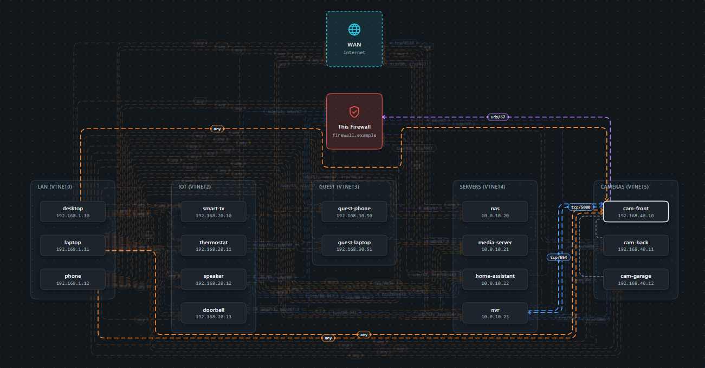

# ControlledBurn

An OPNsense plugin that maps **who can reach whom** on your network under the
firewall rules you actually have loaded.

[](https://haminatin.github.io/ControlledBurn/demo/)

**[Try the interactive demo](https://haminatin.github.io/ControlledBurn/demo/)**:
sample networks, running entirely in your browser.

It reads the live pf ruleset and your devices (dnsmasq's DHCP leases and
host entries) and draws a graph. A directed edge from one device to another, or
to **This Firewall** (the firewall's own addresses: GUI, SSH, DNS and so
on), means the first can open a connection to the second,
with the protocols and ports that get through. The graph shows what the rules
*allow*, not live traffic, so it also exposes holes nobody is using yet.

- **Blue** edges are flows a rule names explicitly: a specific host, the
  destination's own network, or the firewall's own address.
- **Orange** edges are let through only by something broader, such as a wider
  network or `any`. These are the ones to review.
- **Green** edges are ones you've marked as checked. A check lapses
  automatically if the rules later change what that edge allows.
- **Grey** links join devices on the same network segment. That traffic never
  crosses the firewall, so no rule can block it.

Click an edge to see the rules behind it, with links to Firewall → Rules.

The default **star** layout puts the firewall in the middle with each
network segment around it and WAN above; a **columns** layout (segments in
a row below the firewall) is the alternative. Drag a node, or a whole
segment by its box, to rearrange: positions are saved per layout ("Reset
layout" puts the current one back), and a filter narrows the graph to
chosen devices or segments on busy networks. Checks persist; if a rule change alters what a checked edge
allows, the edge is marked "changed" and shows what it allowed before.

A **Rule check** bar above the graph lists rules that can never take effect
because another rule always decides first. For example, a block placed
below a broad "allow LAN to any" never fires.

> **Status: early development.** The install steps below have been run on a
> test OPNsense 26.7 VM and install cleanly. The plugin's behaviour on a real
> box is still being checked. Use a test firewall (a VM is ideal), not your
> production one.

## Features

Beyond the basic graph, things you might not expect:

- **The rules pf actually runs.** Rules come from the loaded ruleset
  (`pfctl`), not just the rules pages, so OPNsense's automatic rules
  (anti-lockout, DHCP, default deny, anti-spoofing), floating rules and
  alias contents are all included. Edges allowed only by OPNsense's own
  defaults are drawn **purple**.
- **Ports, not just yes/no.** Every edge lists the protocols and ports that
  get through, with ranges from several rules merged. It says **any** when
  every protocol and port is allowed. A **Port names** switch shows
  `tcp/ssh` instead of `tcp/22`.
- **What can reach the firewall itself.** Arrows into **This Firewall**
  show which devices can reach its own services (GUI, SSH, DNS), including
  through its WAN address from inside, which surprises people.
- **Port forwards and internet exposure.** Inbound edges from **WAN** show
  what the internet can reach through port forwards (`rdr`, `rdr pass`,
  `no rdr`) and WAN rules. Forwards that translate traffic but are then
  blocked, and Destination NAT entries that can't work (no target, port
  in the wrong field), are flagged.
- **IPv6, separately from IPv4.** Each family is evaluated on its own.
  Devices' IPv6 addresses come from the neighbour table, or are assumed
  (EUI-64) when a device has been idle. The classic hole, IPv6 allowing
  what the IPv4 rules block, is called out. There's no internet over IPv6
  unless the WAN actually has a global IPv6 address.
- **Rule check.** It lists:
  - rules that can never take effect because another rule always decides
    first;
  - aliases that are empty in the live firewall (saved but never applied);
  - port forwards that do nothing.
  Hovering a dead rule highlights the flows it was written for.
- **Full breakdown between any two nodes.** Shift-click two nodes, or use
  an edge's card, to see everything allowed **and** blocked between them,
  port by port, with the rule that decides each.
- **Audit sign-off.** Mark edges as checked (**green**). If the rules
  later change what a checked edge allows, it's marked **changed** and
  shows what it allowed before, so a stale sign-off can't hide a new hole.
- **Honest about uncertainty.** Where a rule can't be evaluated fully (for
  example a table pf couldn't read), the edge is drawn **amber** as
  possibly allowed, not guessed. pf lines it couldn't parse are listed.
- **A readable graph on busy networks.** Edges are bundled metro-map
  style into parallel lanes that cross as little as possible. Choose star
  or columns layouts, drag nodes or whole segments, filter by device,
  segment or alias, and hide same-segment links.
- **Filtering never hides access.** When the filter hides devices, each
  visible device keeps a link to a dashed pill standing in for each hidden
  segment it can reach, or be reached from ("IoT · 4 hidden"), coloured by
  the most concerning of those links. Its card lists every hidden device
  and its rules; click the pill to show the segment again.

**Not covered (yet):**
- Devices from Unbound host overrides, or DHCP leases from ISC DHCP or
  Kea. Only dnsmasq is read.
- Live traffic. This shows what the rules allow, not what is happening.
- Policy routing (`route-to` gateways). Rules are evaluated for pass/block
  only.

## Security and privacy

- **Who can open it.** The page shows your whole security posture: every
  firewall rule, every device with its IP and MAC address, port forwards
  and what is exposed to the internet. Access is one privilege,
  **Firewall: ControlledBurn** (System → Access → Groups/Users). Treat it
  as admin-only and don't grant it to anyone you wouldn't show your rules
  to.
- **Nothing leaves the firewall.** ControlledBurn makes no outbound
  connections: no update checks, no telemetry, no externally hosted fonts
  or scripts. It reads the live ruleset and device lists locally and
  stores its own state (layout, checked edges) in `config.xml`.
- **Device names are claims.** Hostnames come from the devices themselves
  (DHCP), so any device can call itself "nas". They're always shown as
  plain text, never as markup. When auditing, trust the IP and MAC on the
  node over the name.
- **Limits.** Past 500 devices the graph isn't evaluated, and past 1,000
  edges it isn't drawn until you narrow it with the filter. A sudden jump
  in devices can mean something on the network is flooding DHCP with
  made-up addresses; the page says so. Saved layouts and checks are capped
  so they can't bloat the configuration.

## Requirements

- OPNsense 26.7. Other versions are untested.
- dnsmasq as the DHCP server (Services → Dnsmasq DNS & DHCP). Devices are
  discovered from its leases and host entries.
- Internet access from the firewall during installation, to fetch the source.

## Install

ControlledBurn isn't in the official plugin list, so you build the package on
the firewall itself from the OPNsense plugins source tree. The result is a
normal `pkg` package, installed and removed the same way as official plugins.

**Before you start, back up your configuration:** in the GUI, **System →
Configuration → Backups**, then **Download configuration**. ControlledBurn
only reads your rules and writes nothing but its own settings section, but a
backup before installing anything on a firewall costs nothing and gives you
a way back.

**You'll need a root shell on the firewall.** Either:

- **The console** (keyboard and screen, or your hypervisor's console): log
  in as `root` and choose **8) Shell**. Nothing to set up.
- **SSH.** Turn it on under **System → Settings → Administration → Secure
  Shell**. Allow root login, listen on **LAN only (never WAN)**, and
  preferably turn password login off and add your public key to the root
  user (**System → Access → Users**, *Authorized keys*). Connect with
  `ssh root@<firewall LAN address>` and choose **8) Shell**. You can switch
  SSH off again afterwards.

Then run these as root on the firewall:

1. Find your OPNsense version. You need the first two numbers, e.g. `26.7`:

   ```sh
   opnsense-version
   ```

2. Install git and fetch the plugins build tree for **your** version
   (replace `26.7` with yours):

   ```sh
   pkg install -y git
   git clone --depth 1 -b stable/26.7 https://github.com/opnsense/plugins /usr/plugins
   ```

3. Fetch ControlledBurn into that tree:

   ```sh
   git clone https://github.com/haminatin/ControlledBurn /usr/plugins/net/controlledburn
   ```

4. Build and install the package:

   ```sh
   cd /usr/plugins/net/controlledburn
   make upgrade
   ```

   This builds `os-controlledburn` and installs it with `pkg`. It then runs
   the standard plugin hooks: it restarts configd and sets up the plugin's
   settings.

5. In the GUI, reload the page and open **Firewall → ControlledBurn**.

## Update

```sh
cd /usr/plugins/net/controlledburn
git pull
make upgrade
```

After an OPNsense major upgrade (e.g. 26.7 → 27.1), switch the plugins tree to
the matching branch before rebuilding:

```sh
cd /usr/plugins
git fetch --depth 1 origin stable/27.1
git checkout -B stable/27.1 FETCH_HEAD
```

## Uninstall

In this order (step 1 needs the plugin still installed):

1. **Optional: clear its saved data.** ControlledBurn keeps your saved
   layouts and checked edges in the configuration (`<controlledburn>` in
   config.xml), and they stay there after the package is removed. To clear
   them, open **Firewall → ControlledBurn** and use **Clear all checks**,
   then **Reset layout** in each layout (switch between Star and Columns).
   An empty `<controlledburn>` section may remain; it's harmless. Please
   don't hand-edit config.xml for this.

2. **Remove the package** (as root, on the shell):

   ```sh
   pkg delete os-controlledburn
   ```

   It may also be listed under **System → Firmware → Plugins**, but as a
   locally built package it isn't in the official catalogue, so the shell
   command is the reliable route. Reload the GUI afterwards; the
   **Firewall → ControlledBurn** menu entry is gone.

3. **Delete the source trees** fetched during install:

   ```sh
   rm -rf /usr/plugins
   ```

4. **Optional: remove git**, if you installed it only for ControlledBurn
   and nothing else on the firewall uses it:

   ```sh
   pkg delete git
   pkg autoremove
   ```

   `pkg autoremove` shows what it will remove (packages pulled in only as
   git's dependencies) and asks before removing anything.

To check it's all gone: `pkg info | grep -i controlledburn` prints nothing.

Your browser also remembers a few viewing preferences for the page (filter,
layout, port names). They're in that browser only and are cleared with the
site's data in the browser settings.

## Development

Repository layout follows the `opnsense/plugins` convention: this directory
is meant to sit at `plugins/net/controlledburn`, and everything under `src/`
is installed into `/usr/local`.

Tests run off the box (PHP 8, Python 3, Node):

```sh
php tests/run_rule_engine_tests.php
php tests/smoke_topology_controller.php
php tests/test_testlab_capture.php
php tests/test_state_controllers.php
php tests/test_scenario_iot.php
php tests/test_testlab_ipv6.php
php tests/test_testlab_nat.php
python3 -I tests/test_get_ruleset.py
node tests/test_topology_js.js
```

For quick iteration against a **test** firewall, `scripts/deploy.sh` copies
`src/` straight onto a box over SSH and runs the same post-install steps,
without building a package. It refuses any host whose hostname doesn't
contain `testlab` unless `CB_FORCE=1` is set. See the script header for setup.

The same suites run on GitHub for every push and pull request
(`.github/workflows/tests.yml`), which also checks the demo page is current.

The interactive demo (`docs/demo/index.html`, served by GitHub Pages) is
built from the plugin's own script and stylesheet plus sample data: the
testlab captures, evaluated by the current engine, and made-up networks.
Rebuild it after changing the engine or the graph code:

```sh
python3 scripts/build_demo.py
```

Edit `docs/demo/template.html`, not `index.html`.

Design notes and the build plan live in [docs/PLAN.md](docs/PLAN.md).

## Feedback and security

Bug reports and ideas are welcome as GitHub issues. Please report security
problems privately instead: see [SECURITY.md](SECURITY.md).

## Licence

BSD 2-Clause, the same licence OPNsense uses. See [LICENSE](LICENSE).
